<p align="center">
  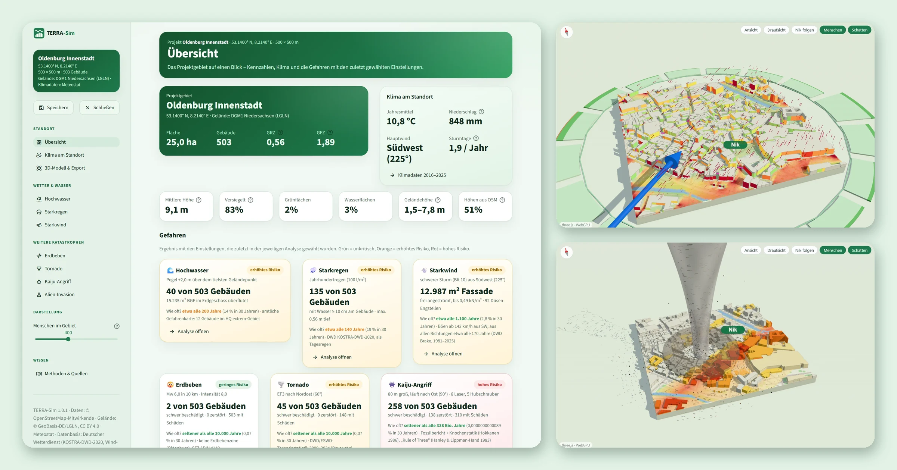
</p>

<p align="center">
  <a href="https://jade-hs-vibecoding-wpk.github.io/TERRA-Sim/"><b>▶ Live-Demo im Browser</b></a>
  &nbsp;·&nbsp; <a href="https://github.com/Jade-HS-Vibecoding-WPK/TERRA-Sim/releases/latest"><b>⬇ Desktop-App für Windows</b></a>
  &nbsp;·&nbsp; <a href="#schnellstart">Aus dem Quellcode starten</a>
  &nbsp;·&nbsp; <a href="#einblick">Bilder</a>
  &nbsp;·&nbsp; <a href="#wissenschaftliche-grundlagen">Methoden &amp; Quellen</a>
</p>

<p align="center">
  <a href="https://github.com/Jade-HS-Vibecoding-WPK/TERRA-Sim/releases/latest"></a>
  <a href="https://github.com/Jade-HS-Vibecoding-WPK/TERRA-Sim/actions/workflows/tests.yml"></a>
  
  
  
  
  
  
</p>

# TERRA-Sim

**3D-Stadtmodell aus offenen Daten – und was Hochwasser, Sturm, Erdbeben oder ein Kaiju damit machen.**

*Terrain, Environment & Resilience Simulator* – ein Werkzeug für Entwurf und Lehre:

- **3D-Modell in Sekunden:** Gebiet auf der Karte wählen, TERRA-Sim lädt Gebäude, Straßen und Flächen aus OpenStreetMap, das amtliche Geländemodell (DGM1, 1-m-Raster) und das Klima der nächsten Wetterstation – und stellt alles als Arbeitsmodell auf einen Sockel, gerendert mit WebGPU.
- **Sieben Gefahren durchspielen:** Hochwasser, Starkregen, Starkwind mit Luftströmung, Erdbeben und Tornado, dazu als Planspiele ein Kaiju-Angriff und eine Alien-Invasion. Jedes Gebäude bekommt ein Ergebnis, animierte Menschen reagieren darauf.
- **Wie wahrscheinlich ist das?** Zu jedem Szenario nennt TERRA-Sim Wiederkehrzeit und Chance in 30 Jahren – aus amtlichen Daten (DWD, Hochwassergefahrenkarten der Länder, GFZ) und Fachliteratur.
- **Nachvollziehbar:** Jede Analyse legt ihren Rechenweg mit Formeln, Annahmen und Grenzen offen; 48 Quellen mit DOI-Links, auch als BibTeX.

> Dozenten-Referenzprojekt und Kurs-Boilerplate der Jade Hochschule (WPK „Thinking Architecture through Software Design“). TERRA-Sim liefert **heuristische Ersteinschätzungen** für den Entwurf, kein Gutachten. Lizenz: Apache 2.0.

<p align="center">
  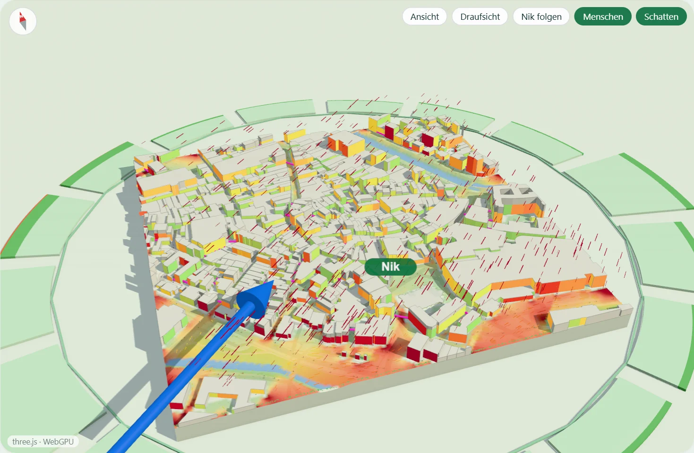
  <br><sub><b>Starkwind, Beaufort 10 aus Südwest:</b> Wind in Fußgängerhöhe, Windteilchen durch die Straßen, frei angeströmte Fassaden – und um den Sockel die Windrose aus zehn Jahren DWD-Messung</sub>
</p>

---

## Inhalt

1. [Drei Wege zu TERRA-Sim](#drei-wege-zu-terra-sim)
2. [Funktionen](#funktionen)
3. [Einblick](#einblick)
4. [Bedienung](#bedienung)
5. [Die Analysen im Detail](#die-analysen-im-detail)
6. [Wie wahrscheinlich ist ein Szenario?](#wie-wahrscheinlich-ist-ein-szenario)
7. [Wissenschaftliche Grundlagen](#wissenschaftliche-grundlagen)
8. [So funktioniert es](#so-funktioniert-es)
9. [Projektstruktur](#projektstruktur)
10. [Schnellstart](#schnellstart)
11. [Befehle](#befehle)
12. [Live-Demo, Desktop-App und Bilder bauen](#live-demo-desktop-app-und-bilder-bauen)
13. [Qualitätssicherung](#qualitätssicherung)
14. [Gestaltung](#gestaltung)
15. [Module einzeln verwenden](#module-einzeln-verwenden)
16. [Grenzen der Simulation](#grenzen-der-simulation)
17. [Datenquellen und Lizenzen](#datenquellen-und-lizenzen)

---

## Drei Wege zu TERRA-Sim

| Weg | Für wen | So geht's |
| :--- | :--- | :--- |
| **Desktop-App** (Windows 10/11) | alle, die einfach loslegen wollen | `TERRA-Sim-…-Setup.exe` aus den [Releases](https://github.com/Jade-HS-Vibecoding-WPK/TERRA-Sim/releases/latest) laden und installieren (ohne Administratorrechte) – oder die portable ZIP entpacken und `TERRA-Sim.exe` starten |
| **Live-Demo im Browser** | zum Reinschauen, ohne Installation | [jade-hs-vibecoding-wpk.github.io/TERRA-Sim](https://jade-hs-vibecoding-wpk.github.io/TERRA-Sim/) – ein fertig berechnetes Beispielgebiet |
| **Aus dem Quellcode** (jedes Betriebssystem) | zum Mitentwickeln und für eigene Module | siehe [Schnellstart](#schnellstart): `pip install -r requirements.txt`, dann `streamlit run app.py` |

Die **Desktop-App** ist dasselbe Streamlit-Werkzeug, mit Python verpackt: Ein kleiner Starter
startet den Server nur auf diesem Rechner (127.0.0.1) und öffnet TERRA-Sim in einem eigenen
Fenster (Microsoft Edge oder Chrome im App-Modus, sonst im Standard-Browser). Schließt man
das Fenster, endet auch der Server. Zwischenspeicher und Protokolle liegen unter
`%LOCALAPPDATA%\TERRA-Sim`. Weil das Programm nicht signiert ist, warnt Windows SmartScreen
beim ersten Start – **Weitere Informationen → Trotzdem ausführen**.

---

## Funktionen

| Funktion | Was passiert |
| :--- | :--- |
| **Projekt anlegen** | Gebiet über Adresse, Koordinaten, Beispielort, Klick oder Rechteck auf der Karte wählen (200–1.500 m Kantenlänge) oder eine Projektdatei öffnen. Erst danach werden Übersicht, Klima, 3D-Modell und Analysen freigeschaltet – wie bei Planungswerkzeugen (z. B. Autodesk Forma). |
| **Daten laden** | Gebäude, Straßen, Grün- und Wasserflächen aus **OpenStreetMap**; Gelände aus dem **amtlichen DGM1** der Länder (1-m-Raster, sonst weltweite Höhenmodelle); Klima der nächsten Station (**Meteostat**, **DWD**); amtliche Daten zur Häufigkeit (**KOSTRA-DWD-2020**, **Hochwassergefahrenkarten**, **DWD-Böen**, **GFZ-Erdbebenzonen**). Alles wird zwischengespeichert. |
| **Übersicht** | Bento-Grid mit Projektkarte, Klima-Steckbrief, Gebietskennzahlen (GRZ, GFZ, Versiegelung, Grünanteil), je Gefahr einer Kachel mit Ampel und „Wie oft?“, der Rangliste „Wie wahrscheinlich ist was?“ und den Exporten (Projektdatei, Kennzahlen als CSV, Gebäude mit allen Ergebnissen als GeoJSON für QGIS). |
| **Klima am Standort** | Klimadiagramm, Windrose, Extremwerte je Jahr, Kennzahlen (heiße Tage, Frosttage, Starkregen- und Sturmtage) – und Szenarien aus den Messdaten zum Übernehmen. |
| **3D-Modell & Export** | LOD 1 (Klötzchen) oder LOD 2 (Dachformen), eingefärbt nach Gebäudehöhe oder Datenquelle; Export als OBJ, STL oder DXF für CAD und 3D-Druck. |
| **3D-Ansicht** | three.js mit **WebGPU** (sonst WebGL 2): Geländesockel wie ein Arbeitsmodell, Sonnenschatten, Umgebungsverdeckung, Gebäudekanten, Kompass, Draufsicht. Gebäude zeigen beim Überfahren ihre Daten. |
| **Sieben Analysen** | Hochwasser, Starkregen, Starkwind (mit Luftströmung am Boden und gemessener Windrose), Erdbeben (EMS-98), Tornado (Rankine-Wirbel), Kaiju-Angriff und Alien-Invasion – jeweils mit Kennzahlen, Legenden und Ergebnis je Gebäude. |
| **Menschen und Nik** | Bis zu 1.000 animierte Figuren laufen auf Straßen und Wegen und reagieren auf die Gefahr; die mit dem Afro ist **Nik** – „Nik folgen“ hängt die Kamera an ihn. |
| **Wie wahrscheinlich?** | Wiederkehrzeit und Chance in 30 Jahren für jedes eingestellte Szenario, aus amtlichen Daten und Literatur – auch für Kaiju (0,0000000000089 %) und Aliens (0,000003 %). |
| **Methode & Quellen** | Auf jeder Analyseseite der Rechenweg mit Formeln, Annahmen (⚙️) und Grenzen; eine eigene Seite mit allen 48 Quellen, Suche und BibTeX-Download. |
| **Live-Demo** | Vorberechnetes Beispielgebiet als statische Seite auf GitHub Pages – mit demselben 3D-Viewer. |
| **Desktop-App** | Installer und portable ZIP für Windows, gebaut und geprüft von GitHub Actions bei jedem Release-Tag. |

---

## Einblick

Alle Bilder zeigen das Beispielgebiet **Oldenburg Innenstadt** (500 × 500 m, 503 Gebäude) mit den Szenarien aus [`docs/bilder/beispielprojekt.terrasim.json`](docs/bilder/beispielprojekt.terrasim.json) – die Datei lässt sich in TERRA-Sim unter **Projekt anlegen → Projektdatei** öffnen.

<p align="center">
  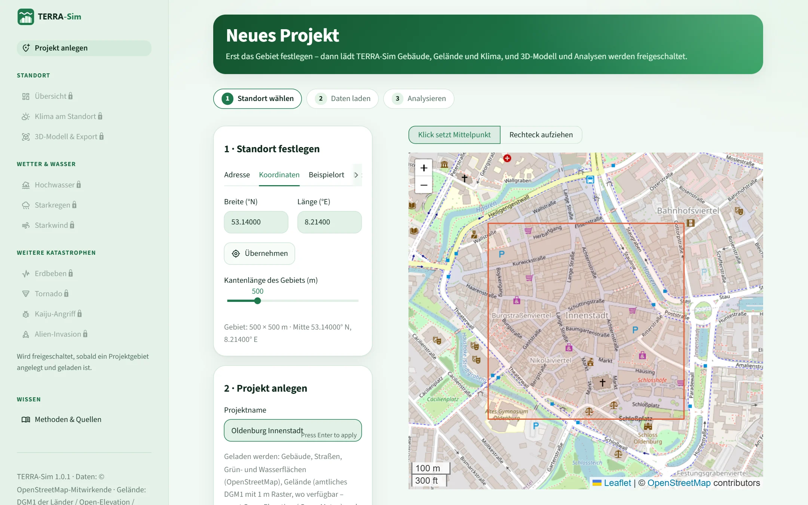
  <br><sub><b>1 · Projekt anlegen:</b> Standort wählen (hier über Koordinaten), Gebiet auf der Karte prüfen, „Projekt anlegen &amp; Daten laden“. Bis dahin sind die Analysen in der Seitenleiste gesperrt.</sub>
</p>

<p align="center">
  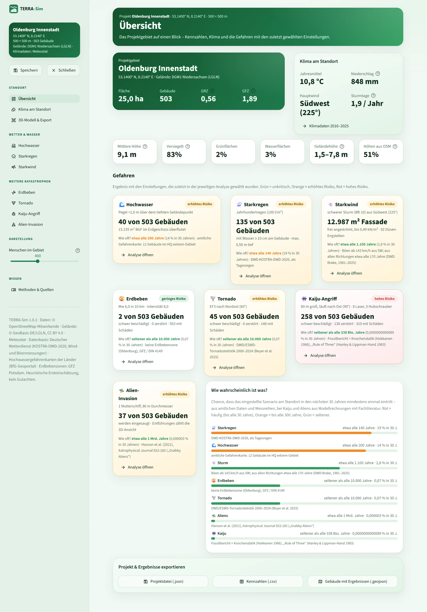
  <br><sub><b>2 · Übersicht:</b> Projekt und Klima, Gebietskennzahlen, je Gefahr eine Kachel mit Ampel (grün, orange, rot) und „Wie oft?“, Rangliste und Exporte</sub>
</p>

### Die 3D-Ansichten

<table>
  <tr>
    <td width="50%" valign="top">
      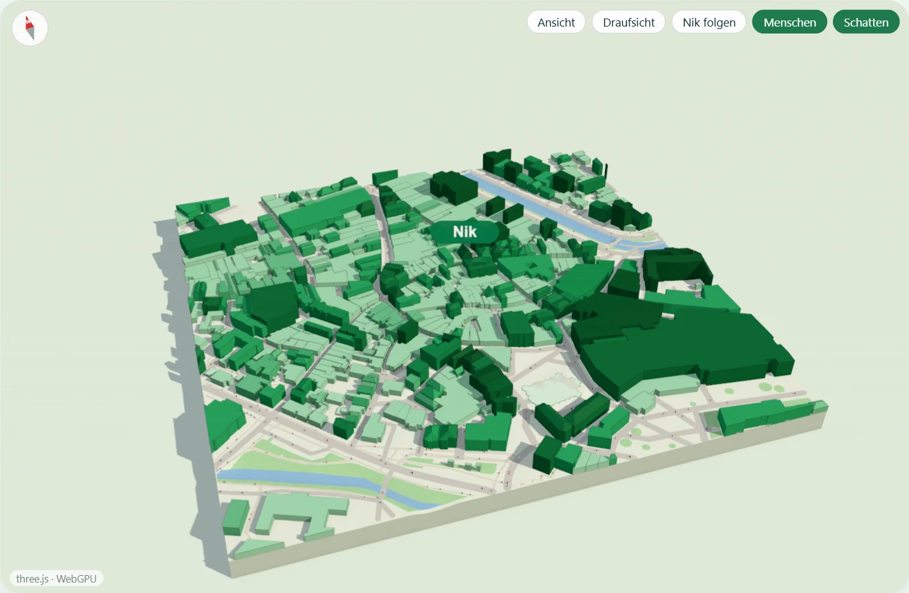
      <p align="center"><b>3D-Modell</b><br><sub>LOD 2 mit Dachformen, Farbe nach Gebäudehöhe, auf dem amtlichen DGM1</sub></p>
    </td>
    <td width="50%" valign="top">
      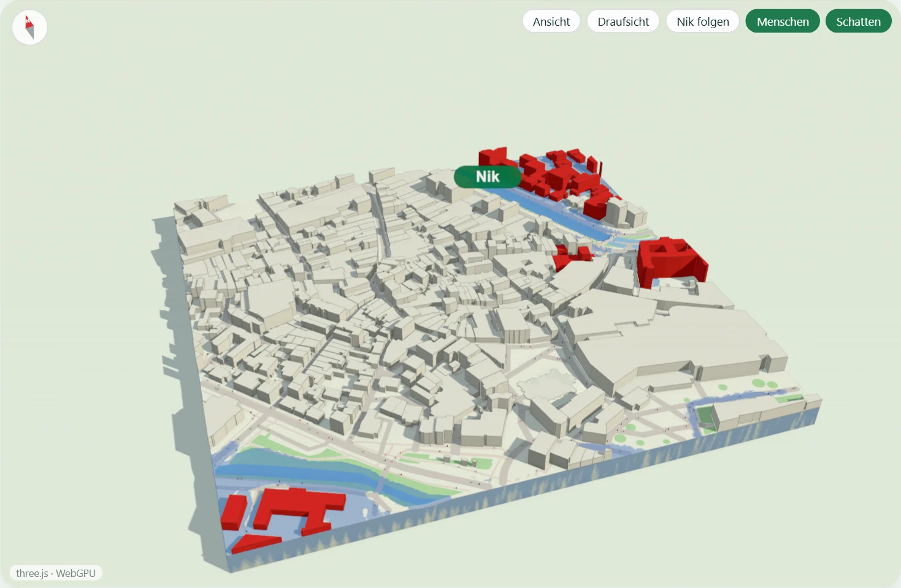
      <p align="center"><b>Hochwasser</b><br><sub>Pegel +2,0 m über dem tiefsten Geländepunkt; Gebäude im Wasser rot</sub></p>
    </td>
  </tr>
  <tr>
    <td width="50%" valign="top">
      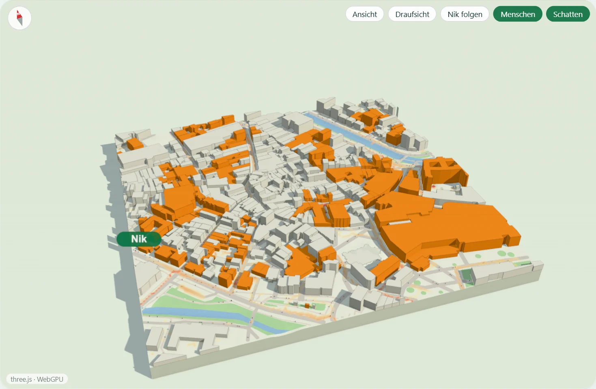
      <p align="center"><b>Starkregen</b><br><sub>Jahrhundertregen 100 l/m²: wo das Wasser abfließt und sich staut, Rückstau-Gebäude orange</sub></p>
    </td>
    <td width="50%" valign="top">
      
      <p align="center"><b>Starkwind</b><br><sub>Bft 10 aus Südwest: Wind am Boden, Windteilchen, Fassaden, gemessene Windrose</sub></p>
    </td>
  </tr>
  <tr>
    <td width="50%" valign="top">
      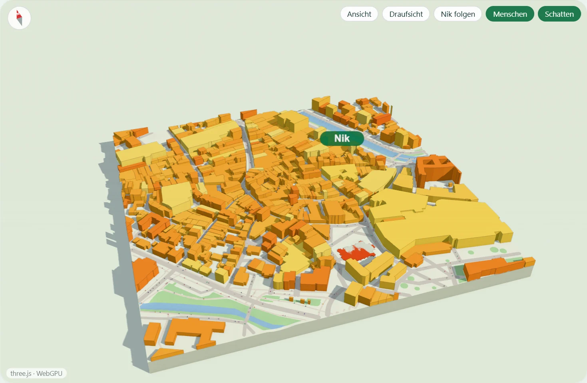
      <p align="center"><b>Erdbeben</b><br><sub>Mw 6,0 in 10 km: Schadensgrad je Gebäude nach EMS-98, schwer beschädigte sacken ein</sub></p>
    </td>
    <td width="50%" valign="top">
      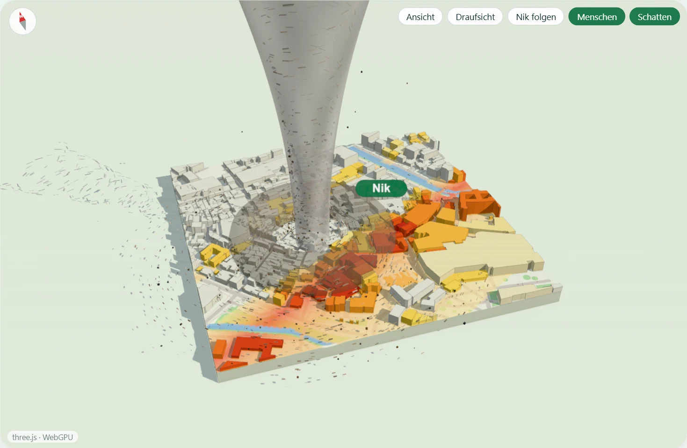
      <p align="center"><b>Tornado</b><br><sub>EF3: Trichter mit Trümmerwirbel, Schäden entlang der Schneise</sub></p>
    </td>
  </tr>
  <tr>
    <td width="50%" valign="top">
      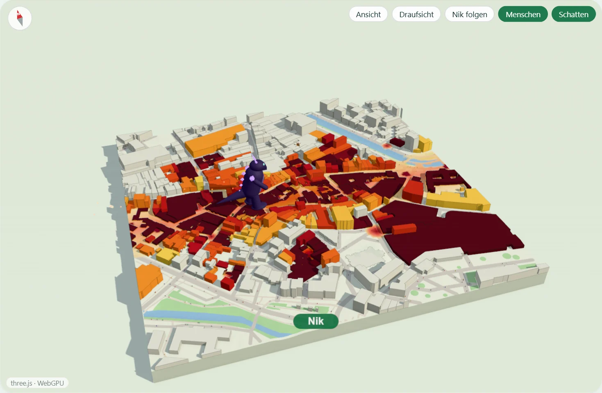
      <p align="center"><b>Kaiju-Angriff</b><br><sub>80-m-Monster mit Laserstrahlen, fünf Hubschrauber greifen an</sub></p>
    </td>
    <td width="50%" valign="top">
      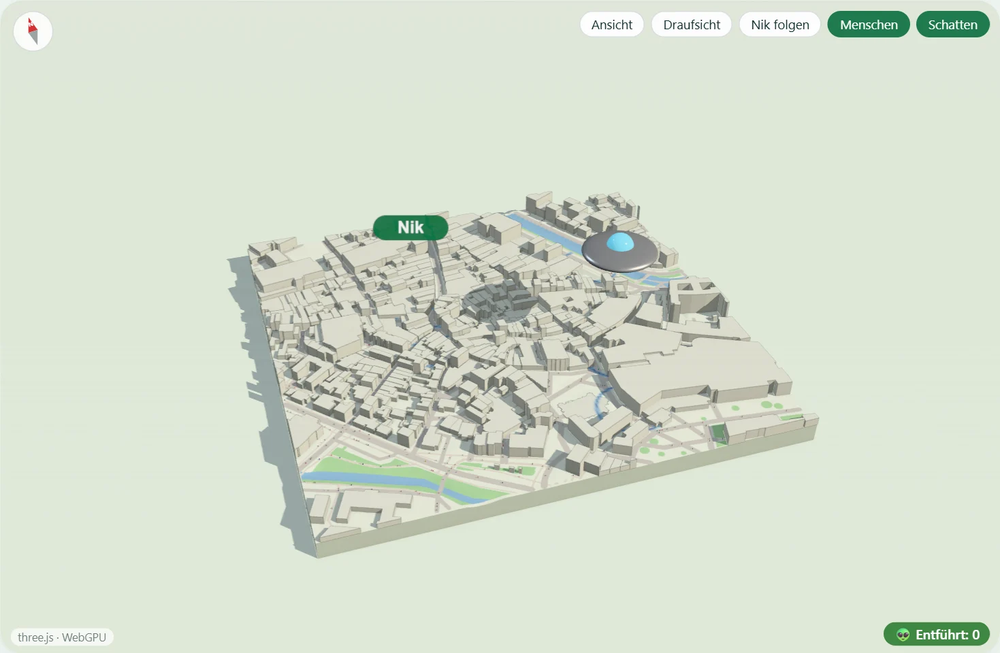
      <p align="center"><b>Alien-Invasion</b><br><sub>Mutterschiff mit 80 m Durchmesser saugt Gebäude ein und zählt Entführungen</sub></p>
    </td>
  </tr>
</table>

### Wie wahrscheinlich ist das?

<table>
  <tr>
    <td width="50%" valign="top">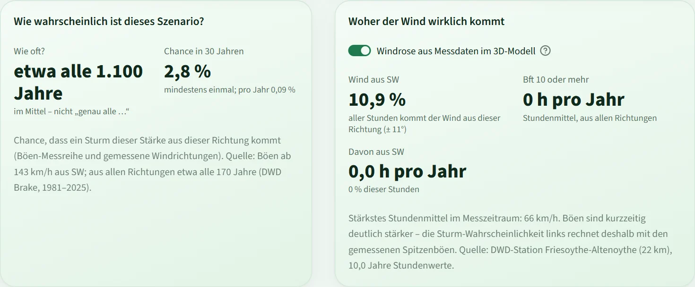<br><sub><b>Starkwind:</b> Gumbel-Verteilung der DWD-Spitzenböen, daneben, woher der Wind wirklich kommt</sub></td>
    <td width="50%" valign="top">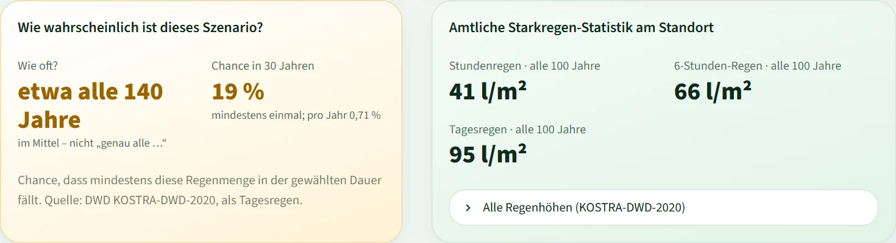<br><sub><b>Starkregen:</b> Wiederkehrzeit aus KOSTRA-DWD-2020, daneben die amtlichen 100-jährlichen Regenhöhen am Standort</sub></td>
  </tr>
  <tr>
    <td width="50%" valign="top">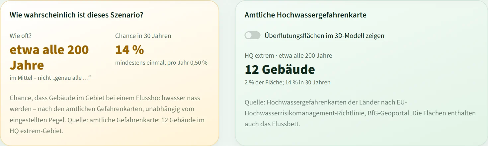<br><sub><b>Hochwasser:</b> häufigstes Szenario der amtlichen Gefahrenkarten, das Gebäude erreicht, mit Gebäuden je Szenario</sub></td>
    <td width="50%" valign="top">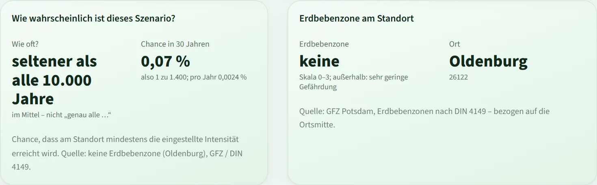<br><sub><b>Erdbeben:</b> Erdbebenzone nach DIN 4149 (GFZ) und Gefährdungskurve</sub></td>
  </tr>
  <tr>
    <td width="50%" valign="top">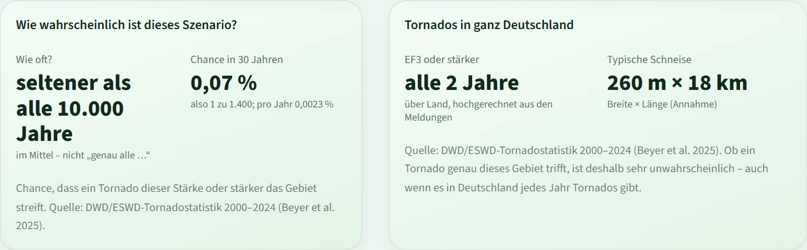<br><sub><b>Tornado:</b> Tornados pro Jahr in Deutschland (DWD/ESWD) × überstrichene Fläche</sub></td>
    <td width="50%" valign="top">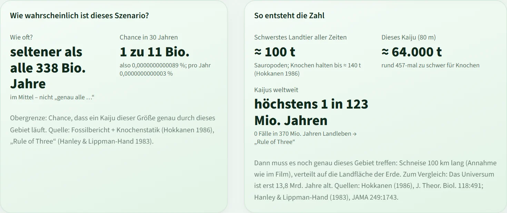<br><sub><b>Kaiju:</b> Obergrenze aus Knochenstatik, Fossilbericht und „Rule of Three“ – 1 zu 11 Bio. in 30 Jahren</sub></td>
  </tr>
  <tr>
    <td width="50%" valign="top">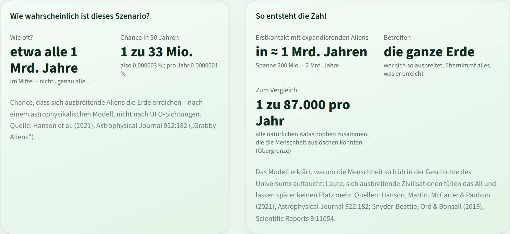<br><sub><b>Aliens:</b> „Grabby Aliens“-Modell aus dem Astrophysical Journal – 1 zu 33 Mio. in 30 Jahren</sub></td>
    <td width="50%" valign="top">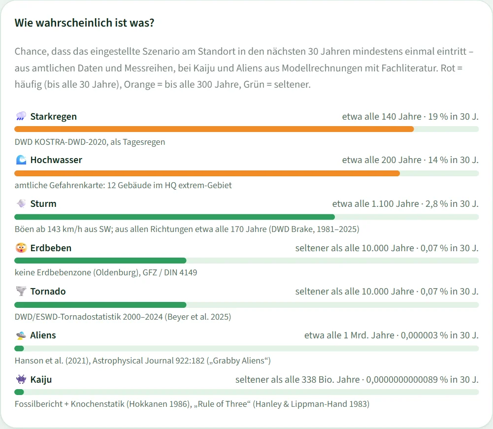<br><sub><b>Rangliste in der Übersicht:</b> alle Gefahren nach ihrer Chance in 30 Jahren – rot häufig, orange mittel, grün selten</sub></td>
  </tr>
</table>

### Methode, Quellen und Klima

<table>
  <tr>
    <td width="50%" valign="top">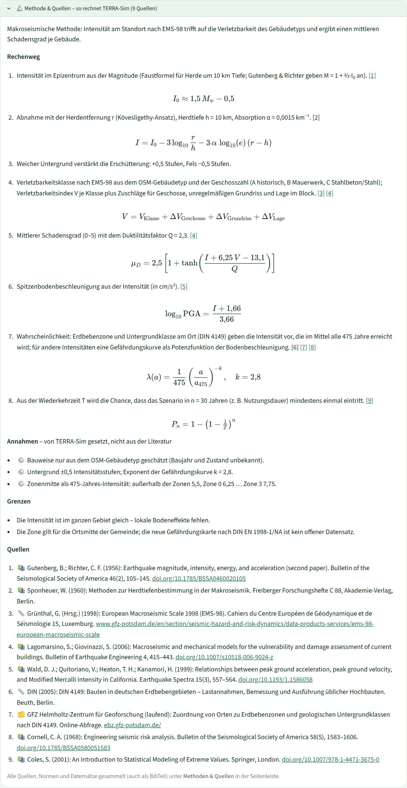<br><sub><b>Methode &amp; Quellen</b> auf jeder Analyseseite: Rechenweg mit Formeln, Annahmen, Grenzen, nummerierte Quellen mit DOI</sub></td>
    <td width="50%" valign="top">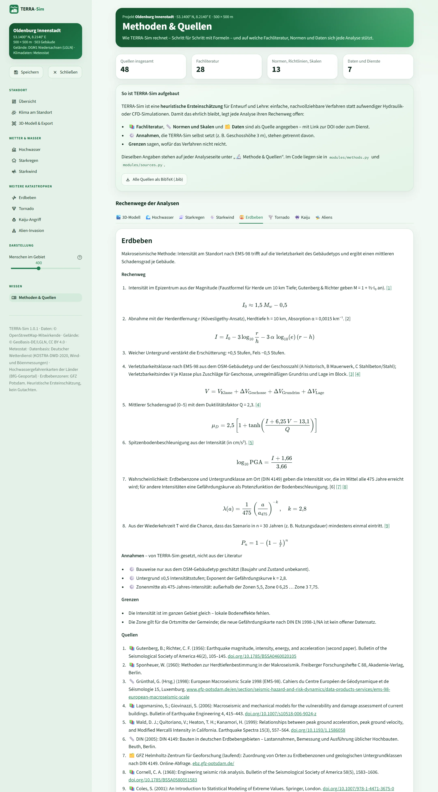<br><sub><b>Methoden &amp; Quellen:</b> alle Rechenwege und 48 Quellen, durchsuchbar, als BibTeX</sub></td>
  </tr>
</table>

<p align="center">
  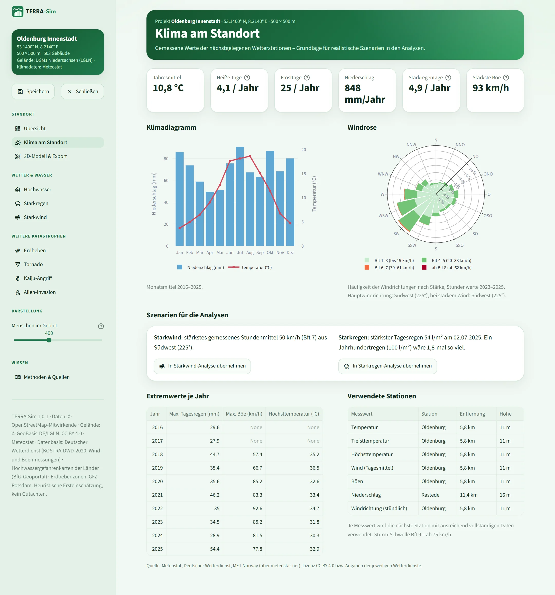
  <br><sub><b>Klima am Standort:</b> Messwerte der nächsten Stationen, Klimadiagramm, Windrose, Szenarien zum Übernehmen</sub>
</p>

### Live-Demo

<table>
  <tr>
    <td width="70%" valign="top">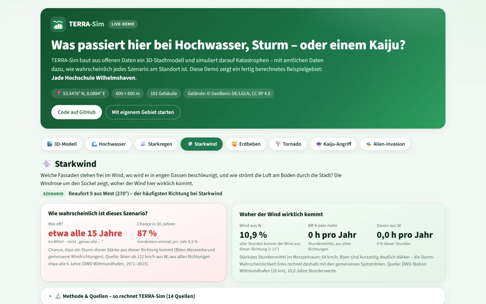</td>
    <td width="30%" valign="top">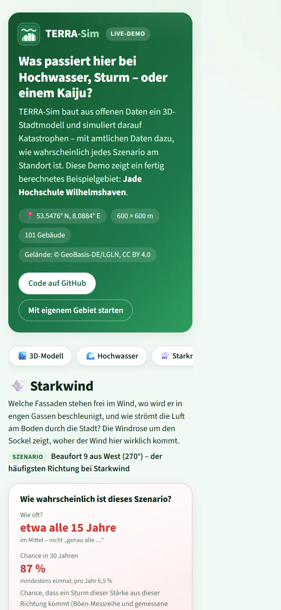</td>
  </tr>
</table>
<p align="center"><sub><b>Live-Demo</b> auf <a href="https://jade-hs-vibecoding-wpk.github.io/TERRA-Sim/">GitHub Pages</a>: vorberechnetes Beispielgebiet mit demselben 3D-Viewer, auch auf dem Smartphone</sub></p>

<sub>Kartenausschnitte und Gebäude in den Bildern: © <a href="https://www.openstreetmap.org/copyright">OpenStreetMap-Mitwirkende</a> (ODbL); Gelände: © GeoBasis-DE/LGLN (CC BY 4.0); Klima und Wahrscheinlichkeiten: Deutscher Wetterdienst (CC BY 4.0), Meteostat, GFZ Potsdam. Die amtlichen Hochwasserflächen sind in den Bildern ausgeblendet. Die Bilder entstehen mit <a href="scripts/screenshots.py"><code>scripts/screenshots.py</code></a>.</sub>

---

## Bedienung

**Ablauf:** erst das Gebiet, dann die Werkzeuge.

1. **Standort wählen** – Reiter *Adresse*, *Koordinaten*, *Beispielort* (Wilhelmshaven, Oldenburg, Passau, Hamburg, Köln) oder *Projektdatei*; alternativ auf die Karte klicken oder ein Rechteck aufziehen. Der Regler setzt die Kantenlänge (200–1.500 m).
2. **Projekt anlegen & Daten laden** – OpenStreetMap, Gelände, Klima und amtliche Daten werden geladen (beim ersten Mal bis zu einer Minute, danach aus dem Zwischenspeicher).
3. **Analysieren** – die Seitenleiste schaltet Übersicht, Klima, 3D-Modell und alle Analysen frei.

| Bereich | Verwendung |
| :--- | :--- |
| **Seitenleiste** | Projektkarte (Lage, Größe, Gebäude, Gelände- und Klimaquelle), **Speichern** (Projektdatei mit allen Einstellungen), **Schließen**, Navigation nach *Standort*, *Wetter & Wasser*, *Weitere Katastrophen*, Regler **Menschen im Gebiet** (0–1.000), *Wissen → Methoden & Quellen* |
| **Analyseseite** | oben „Wie wahrscheinlich ist dieses Szenario?“ und die Datenkarte dazu, darunter „🔬 Methode & Quellen“ zum Aufklappen; links die Einstellungen (Vorlagen und Regler), rechts Kennzahlen, 3D-Ansicht und Legenden |
| **3D-Ansicht** | linke Maustaste verschieben, rechte Taste drehen und kippen, Rad zoomen, Gebäude überfahren für Details; Knöpfe **Ansicht** (zurücksetzen), **Draufsicht**, **Nik folgen**, **Menschen** (anhalten/ausblenden), **Schatten**; der Kompass richtet nach Norden aus |
| **Übersicht** | Kacheln „Analyse öffnen“ springen zur Seite; unten die Exporte |
| **Desktop-App** | Startfenster „TERRA-Sim startet …“, dann das App-Fenster; Fenster zu = TERRA-Sim beendet |

> Ein Neuladen der Browserseite beendet die Sitzung. Mit **Speichern** lässt sich das Projekt als Datei sichern und unter *Projektdatei* wieder öffnen.

---

## Die Analysen im Detail

Jede Analyse liefert Kennzahlen, ein Ergebnis je Gebäude und eine 3D-Ansicht. Die Farben folgen einer Regel: **grün** unkritisch, **orange** Warnung, **rot** Gefahr und Schaden; Wasser bleibt blau.

### 🌦️ Klima am Standort
* Messdaten der nächstgelegenen Wetterstationen der letzten 10 Jahre (Meteostat, DWD).
* Klimadiagramm, Windrose, Extremwerte je Jahr, Kennzahlen wie heiße Tage, Frosttage, Starkregen- und Sturmtage.
* **Verknüpft mit den Analysen:** Hauptwindrichtung bei Starkwind und gemessene Windstärken als Wind-Szenarien, der stärkste gemessene Tagesregen als Starkregen-Szenario.

### 🗺️ 3D-Modell & Export (LOD 1–2)
* Gebäude-Grundrisse, Geschosszahlen und Dachformen aus OpenStreetMap; fehlende Höhen aus der Geschosszahl (× 3 m) oder dem Gebäudetyp geschätzt.
* **LOD 1** (Klötzchenmodell) und **LOD 2** (Dachformen, sofern in OSM hinterlegt); Einfärbung einheitlich, nach Höhe oder nach Datenquelle der Höhe.
* **Gelände:** in Niedersachsen, NRW, Bayern, Berlin/Brandenburg, Hessen, Mecklenburg-Vorpommern und Rheinland-Pfalz das **amtliche DGM1** (1-m-Raster aus Laserscanning), sonst weltweite Höhenmodelle.
* Export als **OBJ, STL oder DXF**.

<details><summary><b>Ganze Seite ansehen</b></summary>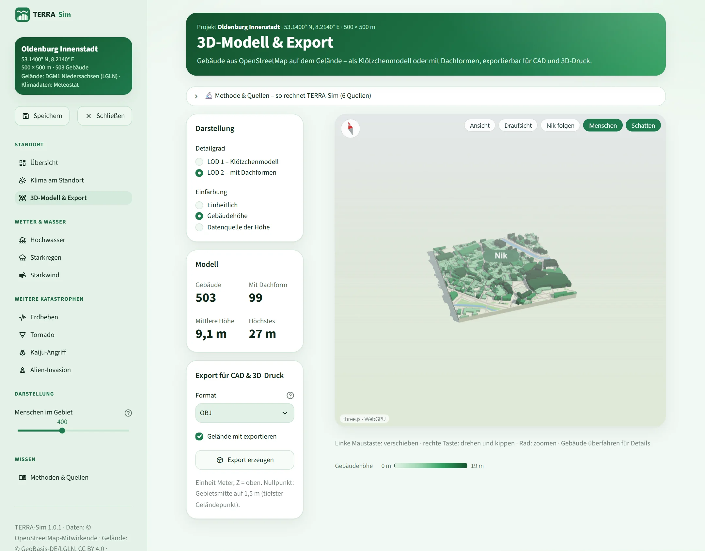</details>

### 🌊 Hochwasser („Badewannen-Modell“)
* Schieberegler für den Wasserpegel (+0,0 bis +10,0 m) über einem wählbaren Bezugsniveau.
* Alles unter dem Wasserspiegel gilt als überflutet; betroffene Gebäude färben sich rot, die überflutete Bruttogrundfläche im Erdgeschoss wird berechnet.
* **Amtliche Hochwassergefahrenkarten:** Gebäude je Szenario (HQ häufig, HQ100, HQ extrem), die Flächen lassen sich im 3D-Modell einblenden.

<details><summary><b>Ganze Seite ansehen</b></summary>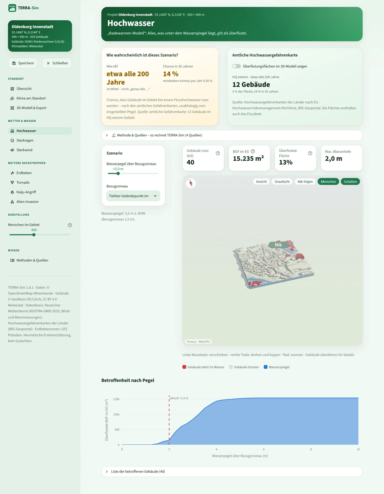</details>

### 🌧️ Starkregen & Oberflächenabfluss
* Szenarien wie der Jahrhundertregen (100 l/m²), gemessene Tagesrekorde und die amtlichen 100-jährlichen Regen aus KOSTRA; Regendauer 1, 6 oder 24 Stunden.
* Abflussbeiwerte je Fläche (Dach, Straße, Grün), **Kanalisation** mit einstellbarer Aufnahme (Standard 20 l/m²), Dachwasser über die **Fallrohre**.
* Senken füllen sich (Priority-Flood), das Wasser folgt den Fließwegen; Heatmap als Risiko-Index, Wassertiefe in Senken oder Abflussbahnen; Gebäude mit Rückstau-Risiko orange.

<details><summary><b>Ganze Seite ansehen</b></summary>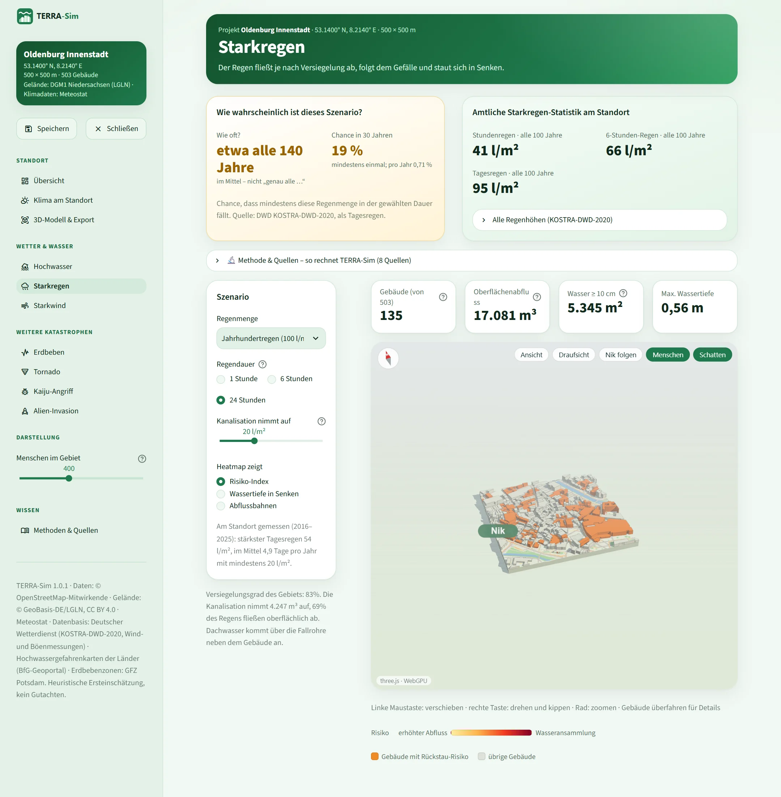</details>

### 💨 Starkwind & urbane Düseneffekte
* Windrichtung (360°) und Windstärke (Beaufort), Vorlagen aus den Messdaten am Standort.
* **Fassaden:** Sichtlinien-Analyse, frei angeströmte Fassaden und Winddruck nach Eurocode; **Düseneffekt** in engen Gassen.
* **Luftströmung am Boden:** Potentialströmung um die Gebäude mit Windschatten, als Heatmap *Wind in Fußgängerhöhe* oder *Windschatten*, mit Kennzahlen (gefährlich windig ab 54 km/h) und **animierten Windteilchen**.
* **Woher der Wind wirklich kommt:** zehn Jahre Stundenwerte der nächsten DWD-Station; in 3D als **Windrose um den Sockel** (Länge = Häufigkeit, Farbe = Stärke). Der Windpfeil lässt sich ausschalten.

<details><summary><b>Ganze Seite ansehen</b></summary>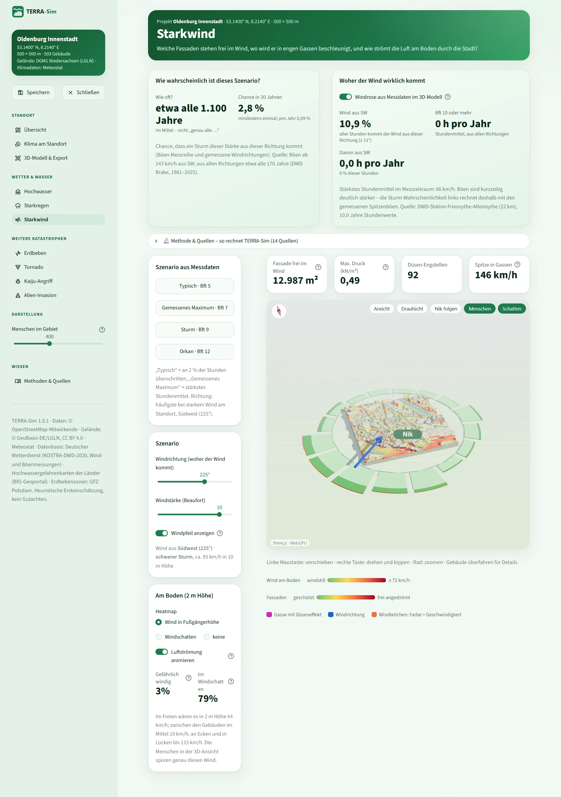</details>

### 🫨 Erdbeben
* Magnitude, Entfernung zum Epizentrum und Untergrund; Vorlagen von „spürbar“ bis „extrem“ (u. a. wie Roermond 1992).
* **Makroseismische Methode** (Lagomarsino & Giovinazzi): Intensität nach EMS-98 × Verletzbarkeit je Gebäude (Klasse aus Typ und Geschosszahl, Zuschläge für Grundriss und Lage im Block).
* Schadensgrad 0–5 je Gebäude; schwer beschädigte sacken in 3D zusammen, das Modell wackelt wie auf einem Rütteltisch.

<details><summary><b>Ganze Seite ansehen</b></summary>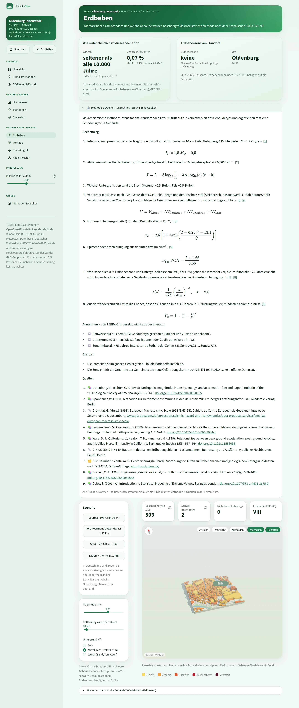</details>

### 🌪️ Tornado
* Stärke nach Enhanced-Fujita-Skala (EF0–EF5), Zugrichtung und Lage der Bahn.
* Wirbel nach Rankine plus Zuggeschwindigkeit (rechts der Bahn stärker); Schaden je Gebäude aus der Windgeschwindigkeit.
* **Animation:** Der Trichter zieht über die Bahn, Staub und Trümmer wirbeln spiralförmig hinein und oben hinaus.

<details><summary><b>Ganze Seite ansehen</b></summary>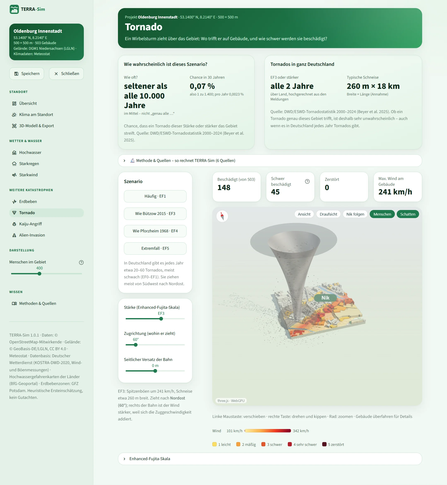</details>

### 👾 Kaiju-Angriff (Planspiel)
* Ein Riesenmonster (eigene Figur, 20–150 m) läuft durch das Gebiet: Schneise, Reichweite von Schwanz und Armen, Erschütterung der Schritte.
* **Kampf:** Laserstrahlen aus den Augen, angreifende Hubschrauber; abgeschossene stürzen in die Stadt – mit festem Zufall, damit Bild und Schadensbilanz zusammenpassen.

<details><summary><b>Ganze Seite ansehen</b></summary>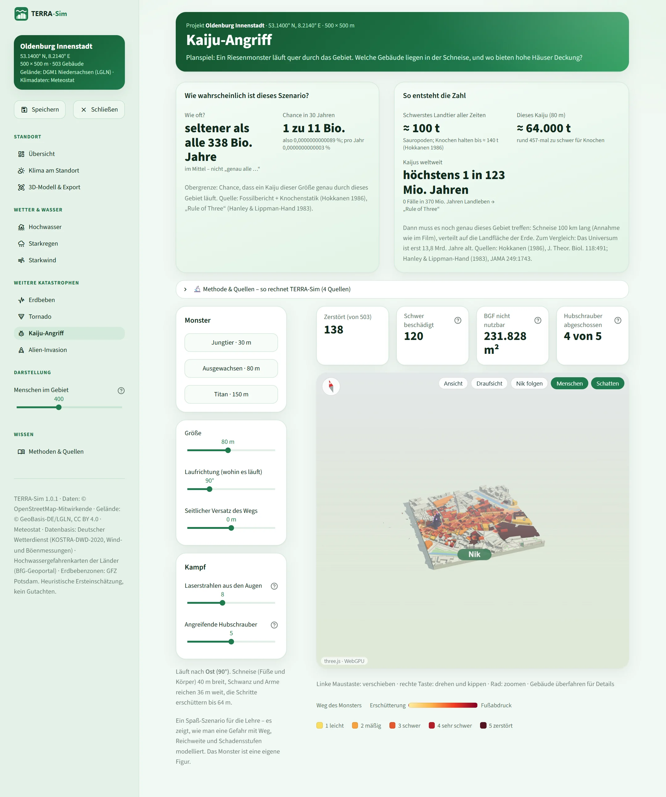</details>

### 🛸 Alien-Invasion (Planspiel)
* 1–5 UFOs kreuzen über dem Gebiet und holen Menschen mit dem Traktorstrahl; die 3D-Ansicht zählt die Entführungen.
* Ab 60 m Durchmesser wird ein UFO zum **Mutterschiff** und saugt Gebäude ein, die drehend nach oben schweben.

<details><summary><b>Ganze Seite ansehen</b></summary>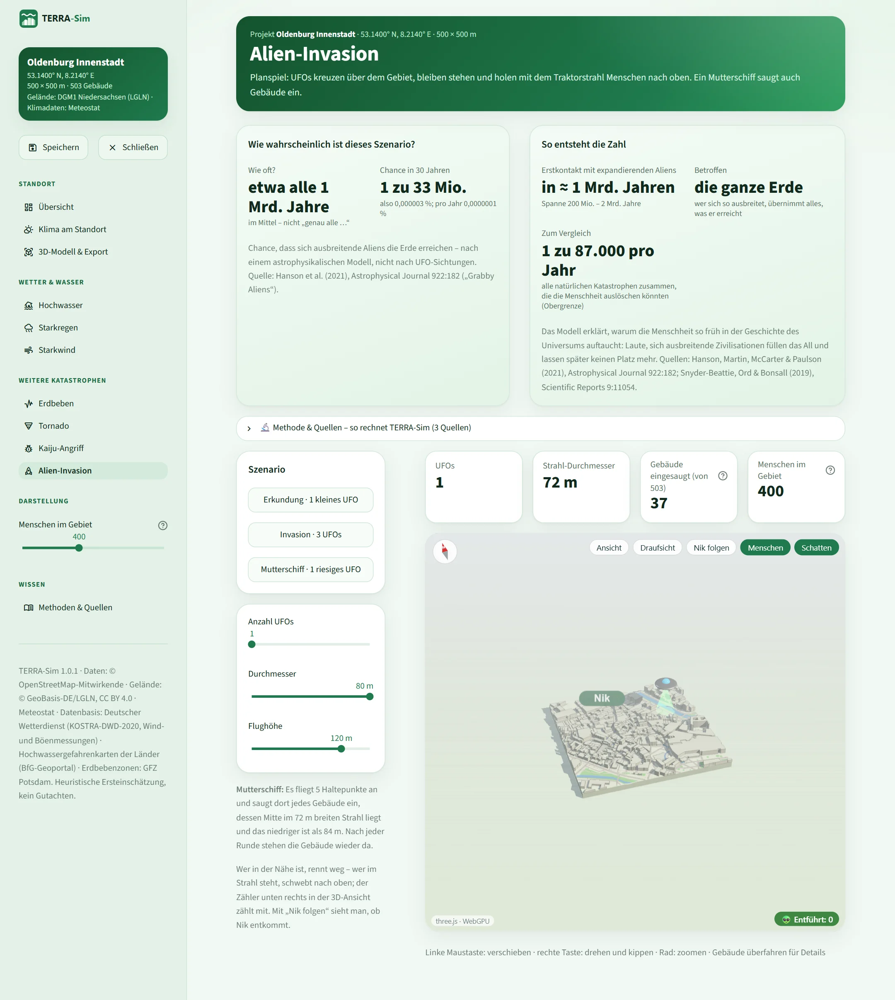</details>

### 🚶 Menschen im Gebiet
* Bis zu 1.000 Figuren laufen auf Straßen und Wegen und reagieren auf die Gefahr: Beim Orkan werden sie je nach Wind an ihrer Stelle weggeweht, der Tornado saugt sie hoch, vor dem Monster fliehen sie, UFOs holen sie ab, beim Erdbeben stürzen sie, im Hochwasser schwimmen sie.
* Die Figur mit dem Afro und dem Namensschild ist **Nik** – **Nik folgen** hängt die Kamera an ihn, auch wenn er durch die Luft fliegt.

---

## Wie wahrscheinlich ist ein Szenario?

Zu jeder Gefahr nennt TERRA-Sim, wie oft das eingestellte Szenario am Standort vorkommt – als **Wiederkehrzeit** („etwa alle 100 Jahre“) und als **Chance in 30 Jahren** (z. B. Nutzungsdauer eines Gebäudes). Rot = häufig (bis alle 30 Jahre), Orange = bis alle 300 Jahre, Grün = seltener.

| Gefahr | Grundlage | So wird gerechnet |
| :--- | :--- | :--- |
| Starkregen | **DWD KOSTRA-DWD-2020** – Regenhöhe je Dauerstufe und Wiederkehrzeit (1–100 Jahre, 5-km-Raster) | Regenmenge des Szenarios in der gewählten Dauer (1 h, 6 h, 24 h) in der KOSTRA-Tabelle nachschlagen, logarithmisch interpoliert |
| Hochwasser | **Hochwassergefahrenkarten der Länder** (EU-HWRM-Richtlinie, BfG-Geoportal): HQ häufig, HQ100, HQ extrem | häufigstes amtliches Szenario, das Gebäude im Gebiet erreicht |
| Sturm | **DWD-Klimastationen**: Jahreshöchstwerte der Spitzenböen; **DWD-Stundenwerte** (10 Jahre) für die Richtung | Gumbel-Verteilung der Jahreshöchstböen, geteilt durch den Anteil der Sturmstunden aus der gewählten Richtung |
| Erdbeben | **Erdbebenzonen nach DIN 4149** (GFZ Potsdam) | Zone = Intensität mit 475-jährlicher Wiederkehr; andere Intensitäten über eine Gefährdungskurve |
| Tornado | **DWD/ESWD-Tornadostatistik 2000–2024** (Beyer, Wapler & Kühne 2025) | Tornados pro Jahr je Stärke × überstrichene Fläche, verteilt auf Deutschland |
| Aliens | Hanson et al. (2021), *Astrophysical Journal* 922:182 („Grabby Aliens“) | Ankunft in etwa 1 Mrd. Jahren, die ganze Erde betroffen → 30 Jahre: rund 0,000003 % |
| Kaiju | Hokkanen (1986), *J. Theor. Biol.* 118:491; Hanley & Lippman-Hand (1983), *JAMA* 249:1743 | Obergrenze: in 370 Mio. Jahren Landleben kein Tier über ~100 t → „Rule of Three“ × Chance, dass die Schneise das Gebiet trifft |

Alle Daten werden beim Anlegen des Projekts geladen und in `.cache/gov/` zwischengespeichert. Fällt ein Dienst aus, läuft die App ohne diese Angabe weiter.

---

## Wissenschaftliche Grundlagen

Jede Analyse legt ihren Rechenweg offen: Auf jeder Analyseseite steht die Karte **🔬 Methode & Quellen** mit Rechenschritten, Formeln, den von TERRA-Sim gesetzten **Annahmen** (⚙️) und den **Grenzen** des Verfahrens. Die Seite **Methoden & Quellen** sammelt alle 48 Quellen – Fachliteratur, Normen und Datensätze mit DOI-Links – und bietet sie als **BibTeX** an. Im Code: `modules/methods.py` (Rechenwege) und `modules/sources.py` (Quellen); ein Test prüft, dass die Zahlen in den Rechenwegen zu den Konstanten im Code passen.

| Analyse | Verfahren | Kernquellen |
| :--- | :--- | :--- |
| 3D-Modell | Grundrisse aus OSM, Höhe aus Geschossen, LOD-Konzept, DGM1 | Biljecki et al. (2016, 2017); OGC CityGML 3.0 |
| Hochwasser | Planares „Badewannen“-Verfahren, amtliche Gefahrenkarten | Teng et al. (2017); EU-HWRM-RL 2007/60/EG |
| Starkregen | Abflussbeiwerte, Kanalkapazität, Priority-Flood, Fließakkumulation, KOSTRA | DIN 1986-100; DWA-A 118; Barnes et al. (2014); O'Callaghan & Mark (1984); LUBW (2016) |
| Starkwind | Beaufort, Potenzgesetz, Winddruck nach Eurocode, Düseneffekt, Potentialströmung, Gefahrenkriterium | DIN EN 1991-1-4; Hellmann (1915); Davenport (1960); Oke (1988); Blocken et al. (2008); NEN 8100; Lawson & Penwarden (1975) |
| Erdbeben | Makroseismische Methode (EMS-98), Intensitätsabnahme, Verletzbarkeitsindex, PGA | Grünthal (1998); Lagomarsino & Giovinazzi (2006); Sponheuer (1960); Wald et al. (1999); Cornell (1968) |
| Tornado | EF/IF-Skala, Rankine-Wirbel, Schneisen, Häufigkeit in Deutschland | WSEC (2006); ESSL (2023); Brooks (2004); Beyer, Wapler & Kühne (2025) |
| Wahrscheinlichkeiten | Wiederkehrzeit, Gumbel-Verteilung, Überschreitungswahrscheinlichkeit | Gumbel (1958); Coles (2001); KOSTRA-DWD-2020 |
| Kaiju · Aliens | Quadrat-Würfel-Gesetz, Knochenstatik, „Rule of Three“ · Grabby-Aliens-Modell | Galilei (1638); Hokkanen (1986); Hanley & Lippman-Hand (1983) · Hanson et al. (2021); Snyder-Beattie et al. (2019) |

---

## So funktioniert es

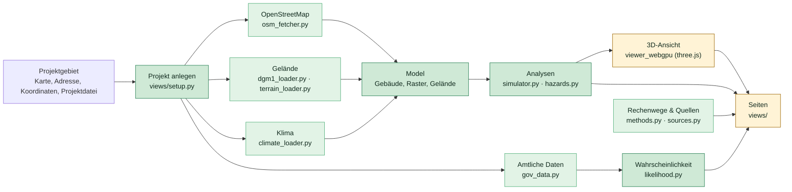

- **Projekt anlegen** (`views/setup.py`): lädt alle Daten und baut daraus das `Model` – Gebäude in Metern mit Geländehöhe, Straßen und ein Raster mit Flächennutzung je Zelle.
- **Analysen** (`modules/simulator.py`, `modules/hazards.py`): reine Rechenfunktionen ohne Oberfläche – Hochwasser, Starkregen, Wind und Windfeld, Erdbeben, Tornado, Kaiju, Aliens; Ergebnis je Gebäude und als Raster.
- **Wahrscheinlichkeit** (`modules/likelihood.py`): Wiederkehrzeiten aus den amtlichen Daten von `modules/gov_data.py`.
- **3D-Ansicht** (`modules/viewer_webgpu/`): `scene.py` baut die Szene mit numpy, `frontend/` rendert sie mit three.js im Browser (Menschen, Windteilchen, Effekte); dieselbe Komponente nutzt die Live-Demo.
- **Seiten** (`views/`): Streamlit-Oberfläche im Bento-Design; Zwischenspeicher sorgen dafür, dass beim Ändern eines Reglers nur neu gerechnet wird, was sich ändert.

| Bereich | Bibliotheken / Dienste | Aufgabe |
| :--- | :--- | :--- |
| Oberfläche | `streamlit`, `streamlit-folium` | Seiten, Regler, Kennzahlen, 2D-Karte |
| Geodaten | `osmnx`, `geopandas`, `shapely`, `pyproj` | OpenStreetMap laden und geometrisch aufbereiten |
| Gelände & Wetter | DGM1 der Länder (WCS, STAC, Kacheln), Open-Elevation, Open-Meteo, `meteostat`, DWD Open Data | Geländehöhen, Klima, amtliche Daten |
| Rechnen | `numpy`, `scipy`, `pandas` | Raster, Senken, Potentialströmung, Statistik |
| 3D | `three.js` (WebGPU/WebGL 2), `plotly` | 3D-Ansicht im Browser, Diagramme |
| Export | `trimesh`, `ezdxf` | OBJ, STL, DXF |
| Verpackung | PyInstaller, Inno Setup, GitHub Actions | Desktop-App, Releases, Live-Demo, Tests |

---

## Projektstruktur

Damit andere Teams einzelne Funktionen leicht übernehmen können, ist der Code strikt getrennt:

```text
terra-sim/
├── app.py                     # Hauptdatei (richtet Oberfläche und Navigation ein)
├── requirements.txt           # benötigte Python-Pakete (requirements-dev.txt: + pytest)
├── .streamlit/config.toml     # Farbschema der Oberfläche
│
├── modules/                   # 🔌 WIEDERVERWENDBARE MODULE
│   ├── map_selector.py        # 2D-Karte & Koordinaten-Auswahl
│   ├── osm_fetcher.py         # Gebäude, Höhen, Straßen & Grünflächen aus OpenStreetMap
│   ├── terrain_loader.py      # Geländehöhen (DEM) mit Rückfall auf weltweite Dienste
│   ├── dgm1_loader.py         # Amtliches DGM1 (1 m) der Bundesländer
│   ├── climate_loader.py      # Klimadaten (Meteostat): Steckbrief, Windrose
│   ├── mesh_builder.py        # 3D-Modell & Export DXF/OBJ/STL
│   ├── simulator.py           # Hochwasser, Starkregen, Wind und Windfeld
│   ├── hazards.py             # Erdbeben, Tornado, Kaiju, Aliens (Schadensgrad 0–5)
│   ├── gov_data.py            # Amtliche Daten: KOSTRA, Hochwasserkarten, DWD-Wind/Böen, Erdbebenzonen
│   ├── likelihood.py          # Wiederkehrzeiten & Wahrscheinlichkeiten
│   ├── methods.py             # Rechenwege je Analyse: Schritte, Formeln, Annahmen, Grenzen
│   ├── sources.py             # Quellen-Register mit BibTeX-Export
│   ├── version.py             # Versionsnummer
│   ├── viewer_webgpu/         # 3D-Ansicht: three.js mit WebGPU (Streamlit-Komponente)
│   │   ├── scene.py           #   baut die Szene – nur numpy
│   │   └── frontend/          #   viewer.js, people.js (Menschen), flow.js (Wind/Tornado), effects.js
│   └── viewer_3d.py           # Farbskalen und einfache pydeck-Szene
│
├── views/                     # 🖥️ SEITEN DER OBERFLÄCHE (Streamlit)
│   ├── navigation.py · common.py · setup.py · overview.py · climate.py · model3d.py
│   ├── flood.py · rain.py · wind.py · earthquake.py · tornado.py · kaiju.py · alien.py
│   └── literature.py          # Methoden & Quellen (auch ohne Projekt erreichbar)
│
├── assets/                    # Logo, Icon und CSS (Bento-Design)
├── tests/                     # ✅ 93 Tests, offline (pytest)
├── demo/                      # 🌐 Live-Demo für GitHub Pages
├── desktop/                   # 🖥️ Desktop-App: Starter, PyInstaller, Inno Setup, Release-Notizen
├── docs/bilder/               # 📸 Bilder dieser README und das Beispielprojekt
├── scripts/                   # build_demo.py, assemble_demo.sh, screenshots.py
└── .github/workflows/         # tests.yml, pages.yml, release.yml
```

---

## Schnellstart

Voraussetzung: Python 3.10 oder neuer.

```bash
# 1. Virtuelle Umgebung anlegen und aktivieren
python -m venv .venv
.venv\Scripts\activate          # Windows (PowerShell: .venv\Scripts\Activate.ps1)
source .venv/bin/activate       # macOS / Linux

# 2. Pakete installieren
pip install -r requirements.txt

# 3. App starten (öffnet sich im Browser unter http://localhost:8501)
streamlit run app.py
```

> Die erste Abfrage eines Gebiets kann bis zu einer Minute dauern, wenn der öffentliche
> OpenStreetMap-Server (Overpass) ausgelastet ist. Danach liegt das Gebiet im lokalen
> Zwischenspeicher (`.cache/`) und lädt sofort.

---

## Befehle

| Befehl | Zweck |
| :--- | :--- |
| `streamlit run app.py` | App starten (http://localhost:8501) |
| `python -m pytest` | alle 93 Tests, ohne Netz (`pip install -r requirements-dev.txt`) |
| `python scripts/build_demo.py` | Daten der Live-Demo neu rechnen (`--name --lat --lon --side` für ein anderes Gebiet, `--methods-only` nur Rechenwege) |
| `sh scripts/assemble_demo.sh .cache/site` | Live-Demo zusammenbauen; ansehen mit `python -m http.server 8510 --directory .cache/site` |
| `python desktop/make_icon.py` | Programmsymbol aus dem Logo zeichnen |
| `pyinstaller desktop/terra-sim.spec --noconfirm` | Desktop-App bauen (`dist/TERRA-Sim/TERRA-Sim.exe`) |
| `dist/TERRA-Sim/TERRA-Sim.exe --selftest bericht.txt` | prüfen, ob im fertigen Programm alles enthalten ist |
| `python scripts/screenshots.py --url http://localhost:8502` | Bilder dieser README neu aufnehmen (App muss auf dieser Adresse laufen) |

---

## Live-Demo, Desktop-App und Bilder bauen

**Live-Demo (GitHub Pages).** GitHub Pages liefert nur statische Dateien aus, TERRA-Sim braucht
aber Python. Die [Live-Demo](https://jade-hs-vibecoding-wpk.github.io/TERRA-Sim/) ist deshalb
**vorberechnet**: `scripts/build_demo.py` lässt jede Analyseseite über Streamlits `AppTest` einmal
laufen – also mit genau dem Code der App – und speichert, was sie anzeigt. Die Seite in `demo/`
schickt die Szene an denselben Viewer wie die App. Nach einem Push auf `main` veröffentlicht
`.github/workflows/pages.yml` die Demo.

**Desktop-App (Releases).** `desktop/terra-sim.spec` packt TERRA-Sim samt Python mit PyInstaller,
`desktop/installer.iss` macht mit Inno Setup einen Installer daraus. Ein Tag wie `v1.0.1` startet
`.github/workflows/release.yml`: Tests → Build → Selbsttest → Server-Start → portable ZIP →
Installer → Testinstallation in einen Ordner mit 140 Zeichen → GitHub-Release. Die Versionsnummer
steht in `modules/version.py`.

**Bilder dieser README.** `scripts/screenshots.py` steuert Microsoft Edge ohne Fenster über das
DevTools-Protokoll (keine Zusatzpakete), tippt auf *Projekt anlegen* die Koordinaten ein, öffnet
das Beispielprojekt `docs/bilder/beispielprojekt.terrasim.json` und fotografiert jede Seite –
ganze Seite, 3D-Ansicht in Nahaufnahme und Ausschnitte – plus die Live-Demo; zum Schluss setzt es
das Vorschaubild zusammen. Alle Bilder sind WebP.

---

## Qualitätssicherung

| Prüfung | Ergebnis |
| :--- | :--- |
| Automatische Tests (`pytest`, ohne Netz) | **93/93** – bei jedem Push und Pull Request (`tests.yml`) |
| Rauchtest aller 12 Seiten (Streamlit `AppTest`) | fehlerfrei, Methoden-Karten und amtliche Daten erscheinen |
| Formeln gegen bekannte Werte | Gumbel-Rückrechnung, KOSTRA-Interpolation, Erdbeben nach Lagomarsino & Giovinazzi, PGA nach Wald et al., Rankine-Wirbel, Massenbilanz beim Starkregen, Winddruck nach Eurocode |
| Rechenwege ↔ Code | `test_methods.py`: Zahlen in `methods.py` passen zu den Konstanten im Code, alle 48 Quellen vollständig, BibTeX gültig |
| Desktop-App | Selbsttest 39/39 im fertigen Programm, Server-Start, Testinstallation in langem Ordner und Deinstallation (`release.yml`) |
| Quellen | unsichere Angaben recherchiert; nicht bestätigte Detailwerte stehen als ⚙️ Annahme, nicht als Zitat |

---

## Gestaltung

**Bento-Grid in Grüntönen:** abgerundete Karten in verschiedenen Tönen (weiß, minze, dunkelgrün), große Kennzahl-Kacheln, ein grüner Seitenkopf.

- **Farben mit Bedeutung:** **Grün** = Normalzustand und Bedienung, **Orange** = Warnung, **Rot** = Gefahr, Schaden, Fehler. Das gilt in Kacheln, Ampeln, Farbskalen und in der 3D-Ansicht; Wasser bleibt blau.
- **Farbskalen:** Schäden gelb → orange → rot → dunkelrot, Wind grün → gelb → orange → rot, Höhe in Grüntönen.
- **Arbeitsmodell:** In 3D steht das Gebiet auf einem hellgrünen Sockel auf einem Tisch, mit Sonnenschatten und Umgebungsverdeckung.

Farben und Formen: [`.streamlit/config.toml`](.streamlit/config.toml) (Theme) und [`assets/style.css`](assets/style.css) (Bento-Karten, Kacheln, Legenden).

---

## Module einzeln verwenden

Jedes Modul funktioniert ohne die App und ohne die anderen Module. Sie tauschen nur einfache Datentypen aus: eine Bounding-Box als Tupel `(west, south, east, north)`, Geodaten als `GeoDataFrame`, Raster als `numpy`-Arrays.

```python
from modules.map_selector import geocode_address, bbox_from_center
from modules.osm_fetcher import fetch_osm, metric_crs
from modules.terrain_loader import load_dem
from modules.climate_loader import load_climate, climate_summary

ort = geocode_address("Schlossplatz, Oldenburg")
bbox = bbox_from_center(ort["lat"], ort["lon"], width_m=500)

osm = fetch_osm(bbox)                    # Gebäude, Straßen, Grün, Wasser
dem = load_dem(bbox)                     # Geländehöhen
gebaeude = osm.buildings.to_crs(metric_crs(bbox))   # in Metern rechnen
print(gebaeude[["building", "height_m", "height_source", "area_m2"]].head())

klima = load_climate(ort["lat"], ort["lon"])        # Meteostat-Messdaten
print(climate_summary(klima)["prcp_max_day"])       # stärkster Tagesregen (mm)
```

---

## Grenzen der Simulation

TERRA-Sim liefert **Ersteinschätzungen für den Entwurf**, keine Gutachten.

* **Geländehöhen:** Das amtliche DGM1 ist für acht Länder eingebunden (`modules/dgm1_loader.py`); sonst, an Landesgrenzen und im Ausland nutzt TERRA-Sim freie globale Höhenmodelle (30–250 m), die in flachen Gebieten um mehrere Meter danebenliegen können. Welche Quelle genutzt wurde, steht in der Seitenleiste.
* **Klimadaten** stammen von der nächstgelegenen Station mit ausreichend Daten (bis 60 km entfernt).
* **Gebäudehöhen** sind in OpenStreetMap oft nicht erfasst und werden dann geschätzt.
* **Hochwasser:** Badewannen-Modell ohne Deiche, Fließwege und Zeitverlauf.
* **Starkregen:** Kanalisation als feste Aufnahmemenge, keine zeitliche Dynamik; ein Gebäude zählt als betroffen, wenn daneben mindestens 10 cm Wasser auf mindestens 25 m² stehen.
* **Erdbeben:** Bauweise aus dem OSM-Gebäudetyp geschätzt, Intensität im ganzen Gebiet gleich.
* **Starkwind:** Sichtlinien-Analyse und Potentialströmung – keine CFD (keine Wirbel, keine Ablösung). Der Düseneffekt ist eine obere Abschätzung.
* **Tornado, Kaiju, Aliens:** einfache geometrische Modelle; Kaiju und Aliens sind Planspiele, ihre Wahrscheinlichkeiten Modellrechnungen.
* **Wahrscheinlichkeiten:** Wiederkehrzeiten über etwa 100 Jahre sind aus 25–70 Jahren Messung nur grob abschätzbar. Die Erdbebenzonen gelten für die Ortsmitte; die neue Gefährdungskarte (DIN EN 1998-1/NA:2021) ist kein offener Datensatz. Die Tornado-Angabe ist ein bundesweiter Mittelwert. Hochwasser umfasst nur Flüsse.
* **3D-Ansicht:** three.js wird beim Öffnen aus dem Internet geladen (jsDelivr).

---

## Datenquellen und Lizenzen

| Daten | Quelle | Lizenz / Hinweis |
| :--- | :--- | :--- |
| Gebäude, Straßen, Flächen | OpenStreetMap-Mitwirkende (Overpass API) | ODbL 1.0 |
| Gelände | DGM1 der Länder (z. B. © GeoBasis-DE/LGLN), sonst SRTM, Copernicus DEM | offene Lizenzen je Land, Quelle in der App |
| Klima | Meteostat (Datenbasis u. a. DWD, MET Norway) | CC BY-NC 4.0 |
| Starkregen, Wind, Böen | Deutscher Wetterdienst (KOSTRA-DWD-2020, Climate Data Center) | CC BY 4.0, „Datenbasis: Deutscher Wetterdienst“ |
| Hochwasser | Hochwassergefahrenkarten der Länder über das BfG-Geoportal | Lizenz dort nicht angegeben – vor einer Veröffentlichung prüfen |
| Erdbebenzonen | GFZ Potsdam (DIN 4149) | Online-Abfrage |
| Literatur | 48 Quellen, siehe App → *Methoden & Quellen* oder `modules/sources.py` | – |

TERRA-Sim selbst steht unter der [Apache-Lizenz 2.0](LICENSE).
